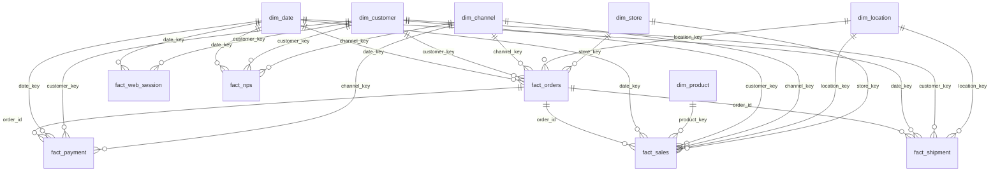

# Trabajo Práctico: Data Warehouse & Dashboard — EcoBottle AR

**Universidad Austral — Licenciatura en Ciencia de Datos**  
**Autor:** Juan Martín Bongiovanni 

---

## 1. Caso de Negocio
**EcoBottle AR** es una empresa de retail en Argentina dedicada a la comercialización de botellas reutilizables (*Classic A Bottle* y *Sport B Bottle*) a través de canales físicos y digitales. 

El objetivo de este proyecto es diseñar e implementar un **Data Warehouse (DW)** bajo un **esquema estrella (metodología Kimball)** y una capa de **Data Marts** utilizando **DuckDB** y **SQL**, transformando los datos transaccionales crudos en un modelo analítico optimizado. A partir de este modelo, se validan y disponibilizan los indicadores clave de rendimiento (KPIs) comerciales, logísticos, de tráfico digital y de satisfacción del cliente (NPS) para la toma de decisiones en un dashboard interactivo en **Power BI**.

---

## 2. Origen de los Datos
Los datos de entrada provienen de archivos CSV transaccionales ubicados en la carpeta `raw/`, los cuales simulan el sistema operacional (OLTP) de la compañía entre enero de 2024 y septiembre de 2025:

- **Maestros y Contexto:** `customer.csv` (clientes), `address.csv` (direcciones postales), `province.csv` (provincias argentinas), `channel.csv` (canales de venta), `store.csv` (tiendas físicas) y `product.csv` (catálogo de productos y precios de lista).
- **Transacciones Comerciales:** `sales_order.csv` (cabecera de pedidos con subtotales, impuestos y costos de envío) y `sales_order_item.csv` (detalle de líneas de producto por pedido, cantidades y descuentos).
- **Operaciones y Pagos:** `payment.csv` (transacciones de cobro y medios de pago) y `shipment.csv` (envíos logísticos, transportistas y fechas de entrega).
- **Comportamiento y Satisfacción:** `web_session.csv` (registro de sesiones de navegación web, tanto de usuarios logueados como anónimos) y `nps_response.csv` (respuestas a encuestas de satisfacción Net Promoter Score).

---

## 3. Estructura del Proyecto

| Ruta | Contenido |
| :--- | :--- |
| `assets/` | Recursos gráficos e imágenes de referencia del proyecto. |
| `dw/` | Carpeta de salida donde se exportan los archivos `.csv` de dimensiones (`dim_*`), hechos (`fact_*`) y data marts (`dm_*`) para Power BI. |
| `dw/modelo_estrella.md` | Diagrama Entidad-Relación en formato Mermaid autogenerado al ejecutar el pipeline. |
| `generator/` | Scripts de generación de los datos transaccionales de muestra. |
| `raw/` | Archivos CSV crudos de origen (esquema `raw` en DuckDB). |
| `sql/01_dimensiones.sql` | Script DDL/DML que crea y puebla las 6 tablas de dimensiones del modelo estrella. |
| `sql/02_hechos.sql` | Script DDL/DML que crea y puebla las 6 tablas de hechos con validación de claves foráneas. |
| `sql/03_consultas.sql` | Consultas SQL de control de calidad (RAW vs DW) y cálculo auditado de los KPIs del negocio. |
| `sql/04_data_marts.sql` | Script que construye los 4 Data Marts desnormalizados y pre-filtrados a partir del modelo estrella para Power BI. |
| `run_sql.py` | Orquestador en Python que reconstruye `warehouse.duckdb`, ejecuta los scripts SQL, exporta los CSV y genera el diagrama. |
| `requirements.txt` | Lista de librerías y dependencias de Python necesarias (`duckdb`). |
| `.gitignore` | Reglas de exclusión para evitar versionar entornos virtuales (`venv/`) y bases binarias (`*.duckdb`). |
| `README.md` | Documentación técnica integral del proyecto, diccionario de datos y manual de ejecución. |

---

## 4. Instrucciones de Ejecución

### 4.1. Instalación y Configuración del Entorno
Desde la consola (PowerShell), posicionarse en la carpeta raíz del repositorio y ejecutar:

```powershell
# 1. Crear el entorno virtual de Python
python -m venv venv

# 2. Activar el entorno virtual (en Windows PowerShell)
.\venv\Scripts\activate

# 3. Instalar las dependencias del proyecto
pip install -r requirements.txt
```

### 4.2. Creación del Data Warehouse y Data Marts
Para construir la base de datos `warehouse.duckdb` desde cero, ejecutar las transformaciones SQL (dimensiones, hechos, consultas y data marts), exportar los archivos CSV a la carpeta `dw/` y actualizar el diagrama del modelo estrella:

```powershell
python run_sql.py
```

### 4.3. Exploración y Validación
Al ejecutar `python run_sql.py`, la consola ejecuta automáticamente todas las sentencias `SELECT` definidas en `sql/03_consultas.sql`, imprimiendo en pantalla tanto las tablas de auditoría de carga como los valores exactos de cada KPI.

---

## 5. Gestión del Repositorio
El control de versiones se realizó íntegramente desde la consola utilizando **Git** bajo la especificación de **Conventional Commits**:
- `feat:` para la creación de tablas de dimensiones, hechos, data marts y consultas de validación.
- `fix:` para ajustes estructurales de grano, recálculo de métricas y correcciones de código.
- `docs:` para la redacción del manual técnico y actualización automática del diagrama en Markdown.

La base de datos local (`warehouse.duckdb`) no se sube al repositorio remoto dado que se regenera de forma determinística mediante `python run_sql.py`, mientras que los archivos `.csv` de `dw/` fueron incluidos en el repositorio para su evaluación directa.

---

## 6. Implementación del Modelo Estrella y Data Marts

El modelo separa las entidades descriptivas (**6 tablas de dimensiones**) de las métricas transaccionales (**6 tablas de hechos**), utilizando claves subrogadas enteras (`_key`), y añade una capa de presentación (**4 tablas Data Mart**) para el consumo directo en Business Intelligence.

| Tabla | Tipo | Grano (¿Qué representa una fila?) | Clave Primaria (PK) |
| :--- | :--- | :--- | :--- |
| `dim_date` | Dimensión | Un día calendario único. | `date_key` |
| `dim_customer` | Dimensión | Un cliente registrado en la plataforma (más fila `-1` para anónimos). | `customer_key` |
| `dim_location` | Dimensión | Una dirección postal asociada a su provincia (más fila `-1` sin dirección). | `location_key` |
| `dim_channel` | Dimensión | Un canal comercial de venta o contacto (Online / Físico). | `channel_key` |
| `dim_product` | Dimensión | Un producto único del catálogo de EcoBottle. | `product_key` |
| `dim_store` | Dimensión | Una sucursal o tienda física de EcoBottle (más fila `-1` para venta online). | `store_key` |
| `fact_orders` | Hechos | La cabecera de un pedido comercial (`raw.sales_order`). | `order_id` |
| `fact_sales` | Hechos | Una línea o ítem de producto dentro de un pedido (`raw.sales_order_item`). | `order_item_id` |
| `fact_web_session` | Hechos | Una sesión de navegación web iniciada en el sitio (`raw.web_session`). | `session_id` |
| `fact_nps` | Hechos | Una encuesta de satisfacción NPS respondida (`raw.nps_response`). | `nps_id` |
| `fact_payment` | Hechos | Una transacción de pago asociada a un pedido (`raw.payment`). | `payment_id` |
| `fact_shipment` | Hechos | Un despacho o envío logístico de un pedido (`raw.shipment`). | `shipment_id` |
| `dm_orders` | Data Mart | Un pedido comercial efectivo (`PAID` / `FULFILLED`) con desglose financiero. | `order_id` |
| `dm_sales_products` | Data Mart | Un ítem vendido en un pedido efectivo con atributos descriptivos de producto y tienda. | `order_item_id` |
| `dm_web_active_users` | Data Mart | Una sesión web con identificador unificado de usuario activo (`CUST_` o `SESS_`). | `session_id` |
| `dm_nps` | Data Mart | Una respuesta NPS con su ponderación matemática pre-calculada (`-100`, `0`, `100`). | `nps_id` |

---

## 7. Diccionario de Datos

### 7.1. Tablas de Dimensiones (`sql/01_dimensiones.sql`)

#### `dim_date`
| Columna | Tipo | Restricciones | Significado |
| :--- | :--- | :--- | :--- |
| `date_key` | `INTEGER` | `PRIMARY KEY` | Clave subrogada de fecha en formato entero `AAAAMMDD` (ej. `20240115`). |
| `full_date` | `DATE` | `NOT NULL` | Fecha calendario completa (`AAAA-MM-DD`). |
| `year` | `INTEGER` | `NOT NULL` | Año calendario (2024, 2025). |
| `month` | `INTEGER` | `NOT NULL` | Número de mes (1 a 12) utilizado para ordenar cronológicamente. |
| `month_name` | `VARCHAR` | `NOT NULL` | Nombre del mes (January a December). |
| `quarter` | `INTEGER` | `NOT NULL` | Trimestre del año (1 a 4). |

#### `dim_customer`
| Columna | Tipo | Restricciones | Significado |
| :--- | :--- | :--- | :--- |
| `customer_key` | `INTEGER` | `PRIMARY KEY` | Clave subrogada del cliente (`-1` reservado para usuario anónimo). |
| `customer_id` | `INTEGER` | — | Identificador natural del cliente en el sistema transaccional (`raw.customer`). |
| `full_name` | `VARCHAR` | — | Nombre y apellido o descripción del cliente. |
| `email` | `VARCHAR` | — | Correo electrónico de contacto. |
| `segment` | `VARCHAR` | — | Segmento comercial o estado del cliente. |

#### `dim_location`
| Columna | Tipo | Restricciones | Significado |
| :--- | :--- | :--- | :--- |
| `location_key` | `INTEGER` | `PRIMARY KEY` | Clave subrogada de ubicación (`-1` reservado para sin dirección especificada). |
| `address_id` | `INTEGER` | — | Identificador natural de la dirección en `raw.address`. |
| `city` | `VARCHAR` | — | Ciudad correspondiente al domicilio. |
| `province_name` | `VARCHAR` | `NOT NULL` | Nombre de la provincia argentina (Buenos Aires, Córdoba, Santa Fe, Mendoza). |

#### `dim_channel`
| Columna | Tipo | Restricciones | Significado |
| :--- | :--- | :--- | :--- |
| `channel_key` | `INTEGER` | `PRIMARY KEY` | Clave subrogada del canal (`-1` reservado para canal desconocido). |
| `channel_id` | `INTEGER` | — | Identificador natural del canal en `raw.channel`. |
| `name` | `VARCHAR` | `NOT NULL` | Nombre comercial del canal (Tienda Online, Tiendas Físicas). |
| `code` | `VARCHAR` | — | Código interno del canal (`ONLINE`, `STORE`). |

#### `dim_product`
| Columna | Tipo | Restricciones | Significado |
| :--- | :--- | :--- | :--- |
| `product_key` | `INTEGER` | `PRIMARY KEY` | Clave subrogada del producto (`-1` reservado para producto desconocido). |
| `product_id` | `INTEGER` | — | Identificador natural del producto en `raw.product`. |
| `sku` | `VARCHAR` | — | Código de referencia de inventario (SKU). |
| `name` | `VARCHAR` | `NOT NULL` | Nombre comercial del producto (`Classic A Bottle`, `Sport B Bottle`). |
| `category` | `VARCHAR` | — | Categoría del producto (`Classic`, `Sport`). |
| `family` | `VARCHAR` | — | Familia de producto (`Bottles`). |
| `list_price` | `DECIMAL(12,2)` | — | Precio de lista unitario vigente. |

#### `dim_store`
| Columna | Tipo | Restricciones | Significado |
| :--- | :--- | :--- | :--- |
| `store_key` | `INTEGER` | `PRIMARY KEY` | Clave subrogada de la sucursal (`-1` reservado para Venta Online / Sin Tienda Física). |
| `store_id` | `INTEGER` | — | Identificador natural de la sucursal en `raw.store`. |
| `store_name` | `VARCHAR` | `NOT NULL` | Nombre de la tienda física (`Tienda BA`, `Tienda CBA`, `Tienda SF`, `Tienda MZA`). |
| `city` | `VARCHAR` | — | Ciudad donde se ubica la sucursal (obtenida cruzando con `raw.address`). |
| `province_name` | `VARCHAR` | — | Provincia donde se ubica la sucursal (obtenida cruzando con `raw.province`). |

---

### 7.2. Tablas de Hechos (`sql/02_hechos.sql`)

#### `fact_orders`
| Columna | Tipo | Restricciones | Significado |
| :--- | :--- | :--- | :--- |
| `order_id` | `BIGINT` | `PRIMARY KEY` | Identificador único de la cabecera del pedido. |
| `date_key` | `INTEGER` | `REFERENCES dim_date(date_key)` | Fecha en la que se realizó el pedido. |
| `customer_key` | `INTEGER` | `REFERENCES dim_customer(customer_key)` | Cliente que efectuó la compra. |
| `channel_key` | `INTEGER` | `REFERENCES dim_channel(channel_key)` | Canal por el cual ingresó la orden. |
| `location_key` | `INTEGER` | `REFERENCES dim_location(location_key)` | Ubicación geográfica asociada a la entrega/facturación. |
| `store_key` | `INTEGER` | `REFERENCES dim_store(store_key)` | Sucursal física donde se realizó la venta (o `-1` si fue canal Online). |
| `status` | `VARCHAR` | — | Estado del pedido (`PAID`, `FULFILLED`, `CANCELLED`, etc.). |
| `subtotal` | `DECIMAL(12,2)` | — | Suma de los `line_total` de los productos del pedido (sin IVA ni envío). |
| `tax_amount` | `DECIMAL(12,2)` | — | Monto de impuestos (21% de IVA sobre el subtotal). |
| `shipping_fee` | `DECIMAL(12,2)` | — | Costo de envío facturado en la orden. |
| `total_amount` | `DECIMAL(12,2)` | — | Importe final facturado (`subtotal + tax_amount + shipping_fee`). |

#### `fact_sales`
| Columna | Tipo | Restricciones | Significado |
| :--- | :--- | :--- | :--- |
| `order_item_id` | `BIGINT` | `PRIMARY KEY` | Identificador único del renglón o ítem dentro del pedido. |
| `order_id` | `BIGINT` | `REFERENCES fact_orders(order_id)` | Pedido cabecera al que pertenece el ítem. |
| `date_key` | `INTEGER` | `REFERENCES dim_date(date_key)` | Fecha de la orden de venta. |
| `product_key` | `INTEGER` | `REFERENCES dim_product(product_key)` | Producto vendido en la línea. |
| `customer_key` | `INTEGER` | `REFERENCES dim_customer(customer_key)` | Cliente comprador. |
| `channel_key` | `INTEGER` | `REFERENCES dim_channel(channel_key)` | Canal de venta. |
| `location_key` | `INTEGER` | `REFERENCES dim_location(location_key)` | Ubicación geográfica del pedido. |
| `store_key` | `INTEGER` | `REFERENCES dim_store(store_key)` | Sucursal física asociada a la venta del ítem (o `-1` si fue Online). |
| `quantity` | `INTEGER` | — | Cantidad de unidades vendidas del producto en esa línea. |
| `line_total` | `DECIMAL(12,2)` | — | Importe neto de la línea (`cantidad * precio - descuento`). |
| `status` | `VARCHAR` | — | Estado del pedido asociado para filtrado rápido. |

#### `fact_web_session`
| Columna | Tipo | Restricciones | Significado |
| :--- | :--- | :--- | :--- |
| `session_id` | `BIGINT` | `PRIMARY KEY` | Identificador único de la sesión web. |
| `date_key` | `INTEGER` | `REFERENCES dim_date(date_key)` | Fecha de inicio de la sesión (`started_at`). |
| `customer_key` | `INTEGER` | `REFERENCES dim_customer(customer_key)` | Cliente identificado o `-1` si se trata de navegación anónima. |
| `source` | `VARCHAR` | — | Fuente de tráfico digital (orgánico, redes, directo, etc.). |
| `device` | `VARCHAR` | — | Dispositivo utilizado (móvil, desktop, tablet). |

#### `fact_nps`
| Columna | Tipo | Restricciones | Significado |
| :--- | :--- | :--- | :--- |
| `nps_id` | `BIGINT` | `PRIMARY KEY` | Identificador único de la respuesta a la encuesta. |
| `date_key` | `INTEGER` | `REFERENCES dim_date(date_key)` | Fecha en que se respondió la encuesta (`responded_at`). |
| `customer_key` | `INTEGER` | `REFERENCES dim_customer(customer_key)` | Cliente encuestado. |
| `channel_key` | `INTEGER` | `REFERENCES dim_channel(channel_key)` | Canal evaluado en la encuesta. |
| `score` | `SMALLINT` | — | Puntaje numérico otorgado (escala de 0 a 10). |
| `nps_category` | `VARCHAR` | — | Clasificación precalculada: `Promotor` (9-10), `Pasivo` (7-8) o `Detractor` (0-6). |

#### `fact_payment`
| Columna | Tipo | Restricciones | Significado |
| :--- | :--- | :--- | :--- |
| `payment_id` | `BIGINT` | `PRIMARY KEY` | Identificador único de la transacción de pago. |
| `order_id` | `BIGINT` | `REFERENCES fact_orders(order_id)` | Pedido que se está abonando. |
| `date_key` | `INTEGER` | `REFERENCES dim_date(date_key)` | Fecha de la orden asociada al pago. |
| `customer_key` | `INTEGER` | `REFERENCES dim_customer(customer_key)` | Cliente que realiza el pago. |
| `channel_key` | `INTEGER` | `REFERENCES dim_channel(channel_key)` | Canal comercial de la operación. |
| `status` | `VARCHAR` | — | Estado de la transacción de cobro. |
| `amount` | `DECIMAL(12,2)` | — | Monto abonado en la transacción. |

#### `fact_shipment`
| Columna | Tipo | Restricciones | Significado |
| :--- | :--- | :--- | :--- |
| `shipment_id` | `BIGINT` | `PRIMARY KEY` | Identificador único del envío logístico. |
| `order_id` | `BIGINT` | `REFERENCES fact_orders(order_id)` | Pedido despachado. |
| `date_key` | `INTEGER` | `REFERENCES dim_date(date_key)` | Fecha de la orden despachada. |
| `customer_key` | `INTEGER` | `REFERENCES dim_customer(customer_key)` | Cliente destinatario. |
| `location_key` | `INTEGER` | `REFERENCES dim_location(location_key)` | Provincia y dirección de destino. |
| `carrier` | `VARCHAR` | — | Empresa transportista encargada del envío. |
| `status` | `VARCHAR` | — | Estado del envío logístico. |
| `shipping_fee` | `DECIMAL(12,2)` | — | Costo del servicio de envío asociado a la orden. |

---

### 7.3. Capa de Data Marts (`sql/04_data_marts.sql`)

#### ¿Por qué y para qué se crearon los Data Marts?
Los Data Marts (`dm_*`) conforman la capa de presentación (**Capa Oro**) del proyecto y fueron diseñados con tres propósitos fundamentales:
1. **Enfoque "Zero-DAX" en Power BI:** Al pre-calcular en SQL las reglas de negocio (exclusión de órdenes canceladas, desglose impositivo/logístico, unificación de usuarios activos y puntuación NPS), Power BI resuelve todos los KPIs usando únicamente agregaciones nativas (*Suma*, *Promedio* y *Recuento distinto*), evitando errores de contexto de filtro.
2. **Aislamiento estricto de la capa `raw`:** Cumpliendo con las buenas prácticas de ingeniería de datos, **ningún Data Mart lee datos de la carpeta `raw/`**. Todos se construyen consultando exclusivamente las tablas de hechos (`fact_*`) y dimensiones (`dim_*`) del Modelo Estrella.
3. **Optimización de consultas visuales:** Conservan las claves subrogadas (`date_key`, `channel_key`, `location_key`, `product_key`, `store_key`) para vincularse con las dimensiones en la Vista de Modelo de Power BI, pero integran los nombres descriptivos más utilizados para agilizar el armado de gráficos.

#### Detalle de las tablas Data Mart (`dm_*`)

* **`dm_orders` (Data Mart de Pedidos Efectivos):**
  * **Para qué sirve:** Alimenta los KPIs de facturación, Ticket Promedio, Órdenes Realizadas, Ventas por Provincia, Ventas por Sucursal y el Desglose Financiero.
  * **De dónde obtiene los datos:** `fact_orders` cruzada con `dim_date`, `dim_channel`, `dim_location` y `dim_store`.
  * **Qué contiene:** Filtra exclusivamente los pedidos efectivos (`status IN ('PAID', 'FULFILLED')`, `10.998` filas). Incluye claves foráneas, atributos temporales, canal (`channel_name`), provincia (`province_name`), sucursal (`store_name`) y las métricas monetarias renombradas: `ventas_sin_impuestos` (`subtotal`), `impuestos` (`tax_amount`), `ventas_sin_envio` (`subtotal + tax_amount`), `costo_envio` (`shipping_fee`) y `ventas_totales` (`total_amount`).

* **`dm_sales_products` (Data Mart de Ventas por Producto):**
  * **Para qué sirve:** Alimenta el anillo de participación por producto, la evolución temporal por tipo de botella y el análisis de productos vendidos por cada tienda física.
  * **De dónde obtiene los datos:** `fact_sales` cruzada con `dim_date`, `dim_product`, `dim_channel`, `dim_location` y `dim_store`.
  * **Qué contiene:** Filtra los ítems correspondientes a pedidos efectivos (`status IN ('PAID', 'FULFILLED')`). Contiene las claves subrogadas, nombre y categoría del producto (`product_name`, `product_category`), canal, provincia, tienda (`store_name`), `unidades_vendidas` (`quantity`) y `ventas_producto` (`line_total`).

* **`dm_web_active_users` (Data Mart de Usuarios Activos Web):**
  * **Para qué sirve:** Resuelve el KPI de Usuarios Activos totales (`73.828`) y su curva de evolución mensual directamente en Power BI mediante un simple *Recuento distinto*.
  * **De dónde obtiene los datos:** `fact_web_session` cruzada con `dim_date`.
  * **Qué contiene:** Genera el campo calculado `usuario_activo_id`. Cuando la sesión pertenece a un cliente logueado (`customer_key != -1`), asigna `'CUST_' || customer_key`; cuando es una visita anónima (`customer_key = -1`), asigna `'SESS_' || session_id`. De este modo, el recuento distinto contabiliza de forma exacta los `3.077` clientes únicos identificados más las `70.751` sesiones anónimas.

* **`dm_nps` (Data Mart de Satisfacción del Cliente - NPS):**
  * **Para qué sirve:** Calcula el Net Promoter Score global (`30,00`) y permite filtrarlo por fecha o canal en Power BI aplicando la operación *Promedio*.
  * **De dónde obtiene los datos:** `fact_nps` cruzada con `dim_date` y `dim_channel`.
  * **Qué contiene:** Conserva el `score` original (`0` a `10`), la categoría (`nps_category`) y añade la columna numérica `puntos_nps`, que asigna **`100.0`** a los Promotores (`score >= 9`), **`0.0`** a los Pasivos (`score` 7-8) y **`-100.0`** a los Detractores (`score <= 6`). El promedio matemático de esta columna equivale exactamente a `(% Promotores - % Detractores)`.

---

## 8. Supuestos y Reglas de Cálculo

1. **Criterio de Ventas Efectivas:** Para todos los indicadores comerciales (Total Ventas, Pedidos Vendidos, Ticket Promedio, Ventas por Provincia, Ventas por Tienda y Ranking por Producto) se consideran únicamente los pedidos con estado `status IN ('PAID', 'FULFILLED')`. Los pedidos cancelados (971 órdenes) se conservan en el Modelo Estrella para trazabilidad histórica pero se excluyen de los KPIs de ingresos y de los Data Marts comerciales.
2. **Desglose Contable del Pedido:** Se respeta la identidad contable del origen de datos:
   > **`total_amount` = `subtotal` + `tax_amount` (21% IVA) + `shipping_fee`**
   * Cuando se analiza la facturación a nivel cabecera (`fact_orders` / `dm_orders`), se reporta tanto el bruto (`total_amount`: **$382,41M**) como sus componentes desglosados (ventas sin impuestos ni envío: **$309,89M**, IVA: **$65,08M**, envíos: **$7,44M**).
   * Cuando se analiza la participación por producto (`fact_sales` / `dm_sales_products`), se suma `line_total`, cuyo total coincide exactamente con el subtotal neto sin impuestos ni envío (**$309,89M**).
3. **Regla de Usuarios Activos:** Un usuario activo en un período se contabiliza combinando los clientes registrados únicos que iniciaron sesión (`COUNT(DISTINCT customer_key)` cuando `customer_key != -1`) más las sesiones únicas de visitantes no logueados (`COUNT(DISTINCT session_id)` cuando `customer_key = -1`).
4. **Cálculo de NPS:** Se categoriza cada respuesta en SQL (`Promotor` >= 9, `Pasivo` 7-8, `Detractor` <= 6) y se calcula el puntaje mediante la fórmula estándar:
   > **`NPS` = ( (`Promotores` / `Total Respuestas`) - (`Detractores` / `Total Respuestas`) ) × 100**

---

## 9. Interpretación de Valores Vacíos (Claves `-1`)
En los datos crudos existen eventos transaccionales donde ciertas claves foráneas vienen vacías (`NULL`), destacándose dos casos propios de la operatoria del negocio:
1. Las **70.751 sesiones web de visitantes anónimos** (`customer_id IS NULL` en `raw.web_session`).
2. Los **pedidos realizados por el canal `ONLINE`**, los cuales no tienen una tienda física asociada (`store_id IS NULL` en `raw.sales_order`).

Para garantizar la **integridad referencial** sin perder registros en los cruces ni dejar claves foráneas nulas en las tablas de hechos:
- Se insertó un registro comodín con clave primaria `-1` ("Cliente Anónimo", "Venta Online / Sin Tienda Física", etc.) en las dimensiones.
- Durante la carga de hechos se aplicó `COALESCE(dim.key, -1)`. De este modo, toda fila de hechos apunta siempre a un registro válido de dimensión y las herramientas de BI pueden agrupar o filtrar tanto el tráfico anónimo como las ventas online de forma explícita.

---

## 10. Consultas Clave (KPIs)

Todas las consultas se encuentran implementadas en `sql/03_consultas.sql`:

| KPI | Tabla de Hechos Principal | Cálculo / Regla SQL | Resultado Auditado |
| :--- | :--- | :--- | :--- |
| **Total Ventas ($M)** | `fact_orders` | `SUM(total_amount) / 1000000.0` filtrando `status IN ('PAID', 'FULFILLED')` (con desglose de `subtotal`, `tax_amount` y `shipping_fee`). | **$382,41 M** (Neto s/imp: $309,89 M) |
| **Pedidos Vendidos** | `fact_orders` | `COUNT(DISTINCT order_id)` filtrando `status IN ('PAID', 'FULFILLED')`. | **10.998 pedidos** |
| **Ticket Promedio ($K)** | `fact_orders` | `SUM(total_amount) / COUNT(DISTINCT order_id)` filtrando `status IN ('PAID', 'FULFILLED')`. | **$34.770,93** ($34,77 mil) |
| **Usuarios Activos (nK)** | `fact_web_session` | `COUNT(DISTINCT CASE WHEN customer_key != -1 THEN customer_key END) + COUNT(DISTINCT CASE WHEN customer_key = -1 THEN session_id END)`. | **73.828 usuarios** (3.077 ident. + 70.751 anón.) |
| **Puntos NPS** | `fact_nps` | `((SUM(Promotores) * 100.0 / COUNT(*)) - (SUM(Detractores) * 100.0 / COUNT(*)))`. | **30,00 puntos** |
| **Ventas por Provincia** | `fact_orders` + `dim_location` | `SUM(total_amount)` agrupado por `province_name` con `status IN ('PAID', 'FULFILLED')`. | Bs. As.: $142,70M \| Córdoba: $89,54M \| Sta. Fe: $87,55M \| Mendoza: $62,63M |
| **Ranking Mensual por Producto** | `fact_sales` + `dim_product` + `dim_date` | `SUM(line_total)` agrupado por `year`, `month`, `month_name` y `product_name` con `status IN ('PAID', 'FULFILLED')`. | Serie de 21 meses desglosada por botella |
| **Ventas por Sucursal Física** | `fact_orders` + `dim_store` | `SUM(total_amount)` y `COUNT(DISTINCT order_id)` agrupado por `store_name` con `store_key != -1`. | Ranking de ventas presenciales por tienda |

---

## 11. Validaciones de Carga y Consistencia

En la sección A de `sql/03_consultas.sql` se ejecutan tres controles automáticos para certificar la calidad del pasaje de `raw` a `dw`:

| Control | Qué comprueba | Resultado Esperado / Obtenido |
| :--- | :--- | :--- |
| **1. Conteo de Filas (RAW vs DW)** | Verifica que ninguna unión (`JOIN`) haya perdido ni duplicado registros al cargar las 6 tablas de hechos. | **100% coincidente:** `fact_orders` (11.969), `fact_sales` (14.573), `fact_web_session` (100.363), `fact_nps` (3.083), `fact_payment` (11.969) y `fact_shipment` (7.009). |
| **2. Conciliación Monetaria** | Comprueba que `SUM(total_amount)` en `raw` sea idéntico al de `fact_orders` y que `subtotal + tax_amount + shipping_fee - total_amount` sea cero. | **Diferencia = `0.00`** ($415.565.574,00 brutos totales y $382.410.636,00 en ventas efectivas). |
| **3. Control de Nulos y Claves `-1`** | Verifica que no existan claves foráneas en `NULL` dentro de las tablas de hechos (incluyendo `store_key`) y contabiliza las asignaciones a `-1`. | **`0` claves foráneas nulas** y `70.751` sesiones web anónimas correctamente mapeadas a `customer_key = -1`. |

---

## 12. Dashboard en Power BI

El tablero interactivo se alimenta de los Data Marts (`dm_*`) y Dimensiones (`dim_*`) exportados en `dw/` y se estructura en tres páginas:
- **Página 1 — Resumen Ejecutivo:** Tarjetas superiores con los 5 KPIs globales (Total Ventas: `$382,41 mill.`, Ticket Promedio: `$34,77 mil`, Órdenes Realizadas: `10.998`, Usuarios Activos: `73.828` y Puntos NPS: `30`), evolución temporal de usuarios activos, evolución mensual por producto, gráfico de anillo de participación por botella (`Sport B Bottle` 52,51% vs `Classic A Bottle` 47,49%) y ranking de ventas por provincia.
- **Página 2 — Análisis de Tiendas y Regiones:** Desempeño comercial por sucursal (`dim_store`), comparativa de ventas por tienda y producto, y mapa geográfico de cobertura provincial en Argentina.
- **Página 3 — Desglose Financiero y Logístico:** Discriminación contable de la facturación bruta (`$382,41 mill.`) separando Venta Neta sin impuestos ni envío (`$309,89 mill.`), IVA (`$65,08 mill.`) y Costo de Envío (`$7,44 mill.`), junto con el análisis de costos de envío por provincia y su evolución mensual.
- **Consideración técnica en Power Query:** Los campos decimales (`ventas_*`, `impuestos`, `costo_envio`, `puntos_nps`) se tipifican utilizando la configuración regional *Inglés (Estados Unidos)* para interpretar correctamente el separador decimal de punto (`.`), y la columna `month_name` de `dim_date` se ordena cronológicamente mediante la columna `month`.

---

## 13. Diagrama del Modelo Estrella

El diagrama completo autogenerado por DuckDB también puede consultarse en [`dw/modelo_estrella.md`](dw/modelo_estrella.md).

